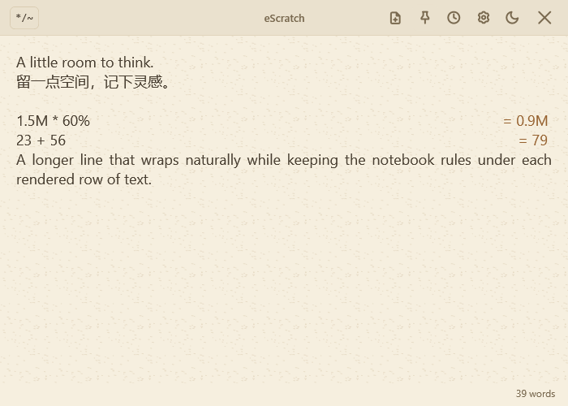

# eScratch 3.0

A scratchpad one keyboard shortcut away. Capture a thought, draft a message, paste text from a screenshot, or work out a quick calculation.

**The latest Windows edition uses WPF and .NET Framework 4.8. It does not require .NET 10 Desktop Runtime.** Active development is on [`wpf-net48`](https://github.com/findliujie-KL/eScratch/tree/wpf-net48).

## Download

[**Download the Windows 3.0 installer**](https://github.com/findliujie-KL/eScratch/releases/download/v3.0.0-net48/eScratch-3.0.0-net48-win-x64-setup.exe) · [Release notes and checksums](https://github.com/findliujie-KL/eScratch/releases/tag/v3.0.0-net48)

For Windows 10/11 x64. The compact installer checks for .NET Framework 4.8+ and the Visual C++ x64 runtime used by OCR, and offers downloads when needed. Packages are unsigned. Existing notes and settings are preserved.

## A place to write



*Actual WPF interface rendered with demonstration text, not personal notes.*

- **Quick access:** Ctrl+J shows the window or brings it forward; press again while active to hide it. The shortcut is customizable. Closing hides the app to the tray; double-click the tray icon to reopen, or use its menu to quit.
- **Simple formatting:** switch between editable bold, italic, strikethrough and their Markdown source. Notes remain plain Markdown. Headings, lists and tables are not rendered.
- **Your paper:** Book paper is the default. Porcelain, Sage notebook and Drafting paper each have light/dark pairs and adjustable texture. Sage rules follow font size, wrapping and zoom.
- **Your typography:** preview installed fonts, choose a base size, and use Left, Center or Justify alignment. Justify is the default. Zoom ranges from 75% to 250%.
- **Choose how to resume:** start blank and archive the previous draft, or enable Reopen last scratch. Optionally open near the pointer, start with Windows, keep the window on top, or copy the draft when hiding. Copy-on-hide is off by default.

## Calculations alongside your notes

Type an expression on its own line, such as `23+56` or `1.5M * 60%`. A result appears at the right, outside the document: selecting or copying the note does not include it.

Click a result to copy it. Right-click for equivalent plain, grouped, percentage or K/M/B/T formats. For example, `3.84M` can be copied as `3,840,000` or `3840K`.

Ctrl+Enter explicitly inserts a result into the note. Repeating it reveals more useful decimal places without trailing zeros. Ctrl+Shift+Enter cycles display units. Select a number and right-click to add separators or convert it to English words.

## History you can find again

Ctrl+H opens a full-window sticky-note board. Search the complete text of saved notes, pin important items, or reopen a note. **Clear unpinned** keeps pinned notes and your current draft. The unpinned history limit defaults to 10 and is configurable.

## Paste text, screenshots and Markdown

- Normal paste uses clipboard text when available, including copied spreadsheet cells. Image-only clips use offline OCR.
- English OCR is bundled. Download additional languages in All settings, select them and arrange their priority. Downloads require internet; recognition runs locally.
- OCR cleans redundant spaces between Chinese characters and can join likely wrapped lines.
- Paste as Markdown converts supported clipboard formatting. Word tracked deletions may be recovered on a best-effort basis when clipboard formats contain different versions of the text; complete revision recovery is not guaranteed.

## Settings and shortcuts

The gear opens **Quick settings** for the toggle shortcut, reopening the last scratch, opening near the pointer, word count and copy-on-hide. **All settings** groups appearance, startup, keyboard, OCR, history and editing options. Changes apply automatically; numeric fields apply on Enter or leaving the field.

**F1** opens Help & shortcuts with your current shortcut assignments.

| Action | Default shortcut |
| --- | --- |
| Show / hide window (system-wide) | Ctrl+J |
| New scratch | Ctrl+T |
| History | Ctrl+H |
| Paste / screenshot OCR | Ctrl+V |
| Paste as Markdown | Ctrl+Shift+V |
| Bold / italic / strikethrough | Ctrl+B / Ctrl+I / Ctrl+Shift+X |
| Insert calculation / more decimals | Ctrl+Enter |
| Cycle calculation units | Ctrl+Shift+Enter |
| Zoom / reset zoom | Ctrl+scroll / Ctrl+0 |
| Help | F1 |

Except for the window toggle, shortcuts operate inside eScratch. System-wide mouse-button triggers are no longer supported.

## Editions and source branches

| Edition | Branch | Status |
| --- | --- | --- |
| Windows 3.0 · .NET Framework 4.8 | [`wpf-net48`](https://github.com/findliujie-KL/eScratch/tree/wpf-net48) | Latest features and active development |
| Windows · .NET 10 WPF | [`wpf-rewrite`](https://github.com/findliujie-KL/eScratch/tree/wpf-rewrite) | Earlier edition; updates deferred |
| Electron · Windows, macOS, Linux | [`main`](https://github.com/findliujie-KL/eScratch/tree/main) | Earlier edition; does not yet contain all Windows 3.0 features |

[All releases](https://github.com/findliujie-KL/eScratch/releases) remain available. Features described above apply to Windows 3.0.

## Build and develop Windows 3.0

Use the `wpf-net48` branch. Install a .NET SDK supporting C# 12 (8+), .NET Framework 4.8+, and the Visual C++ x64 runtime. The SDK is a development tool, not a runtime requirement for users.

```powershell
git checkout wpf-net48
./windows/run.ps1

dotnet build windows/eScratch.Tests/eScratch.Tests.csproj
./windows/eScratch.Tests/bin/Debug/net48/eScratch.Tests.exe

./windows/build.ps1 -Publish
./windows/build-installer.ps1
```

Portable builds are complete folders distributed as ZIPs, not single executable files. Keep the EXE, configuration, DLLs, Assets and x64 folders together. Build output is under `windows/artifacts/net48`.

Notes, settings and OCR languages are stored in `%LOCALAPPDATA%\eScratch\Wpf`, including for portable builds. The .NET 10 WPF edition shares this profile and application identity; exit it before switching editions. Uninstall preserves application data.

[Windows development guide](https://github.com/findliujie-KL/eScratch/blob/wpf-net48/windows/README.md) · [Changelog](https://github.com/findliujie-KL/eScratch/blob/wpf-net48/CHANGELOG.md)

## License and acknowledgements

MIT-licensed, based on [lef237/one-time-editor](https://github.com/lef237/one-time-editor). Third-party components retain their own licenses; see [third-party notices](https://github.com/findliujie-KL/eScratch/blob/wpf-net48/windows/THIRD-PARTY-NOTICES.txt). The WPF editor includes AvalonEdit 6.3.1 with a documented local alignment patch.
